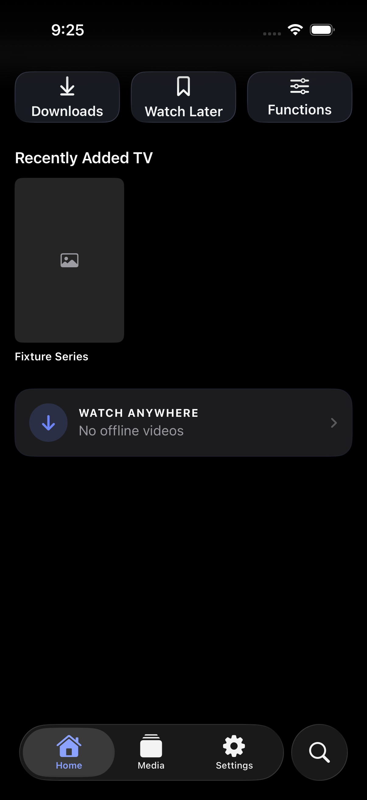
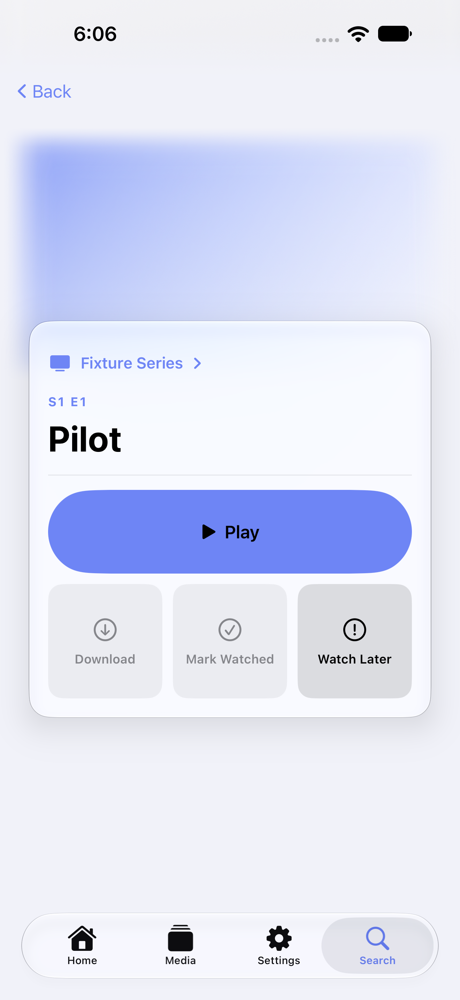
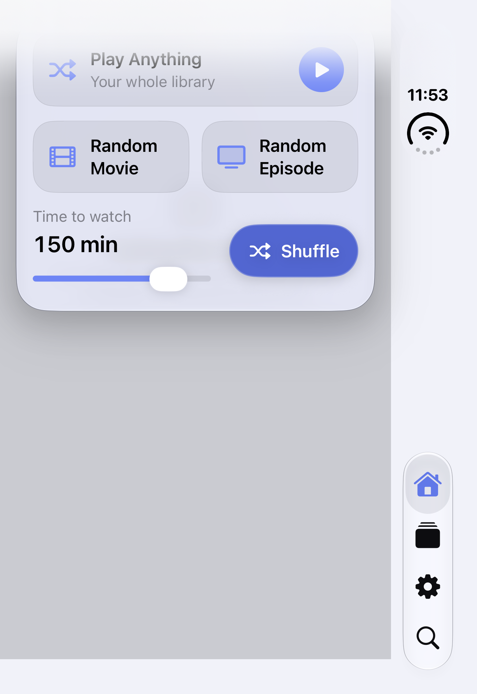

# Cuehouse

**A native Plex media client for iPhone, iPad, Mac, and Apple TV.**

Cuehouse is my independent app project, built around a simple goal: make it easier to enjoy a personal media collection with a focused interface and practical playback controls.

## Interface showcase

**App interface shown with sample data.** These are actual development screenshots from fixture runs, reviewed for public sharing. Placeholder artwork and disabled actions reflect the test setup.

<table>
<tr>
<th>Home</th>
<th>Episode details</th>
<th>Viewing choices — iPhone Duo simulator</th>
</tr>
<tr>
<td></td>
<td></td>
<td></td>
</tr>
<tr>
<td>Quick access to downloads, Watch Later, and viewing functions.</td>
<td>A clear title hierarchy and prominent primary action, with related actions grouped below.</td>
<td>Choose a random movie or episode, or set the time available to watch. Captured on the iPhone Duo simulator; its layout differs from the standard iPhone portrait view.</td>
</tr>
</table>

Select an image to inspect the full-size screenshot. Home was recaptured on November 1, 2026 from a fresh simulator build after removal of the duplicate Downloads entry. Viewing choices was rebuilt and recaptured on the iPhone Duo simulator on November 1, 2026. Episode details is from an October 2026 fixture run. They illustrate interface design with sample data, not a live media library.

## Why I’m building it

I wanted a client tailored to the way I use my own media library. Plex provides the backend; Cuehouse focuses on the browsing and viewing experience across Apple devices.

My priorities include reducing the effort of choosing what to watch, making everyday playback controls easier to reach, and adapting the interface to each device.

## Product focus

- **Library browsing and search:** find media in a personal Plex library.
- **Playback controls:** shape the player around everyday viewing needs.
- **Sleep timers and queues:** give viewers more control over a viewing session.
- **Randomized selection:** help choose something to watch when browsing becomes a chore.
- **Platform-specific interaction:** account for touch, desktop use, and the Apple TV remote.

Cuehouse remains in active development. Features and behavior continue to evolve as I refine the app.

## My role

I define the product’s behavior, specify workflows, and direct AI-assisted implementation and troubleshooting. My process is iterative: I describe the intended experience, assess the resulting behavior, and revise the design and requirements.

This project reflects my work in product direction, behavior specification, and iterative interface design.

## Project technologies

Swift · SwiftUI · AVKit / AVFoundation · Xcode · Plex integration

These are technologies used by the project. Implementation is heavily AI-assisted.

## Current status

Preparing for publication, with ongoing feature development and bug testing. A public release is not yet announced.

## Testing and validation

Historical validation reports record **1,494 iOS unit tests and 176 tvOS unit tests passing** in separate October 3, 2026 simulator runs after playback-validation fixes, with zero failures or skips. Four selected iPad UI tests also passed in the audit baseline.

Useful coverage includes simulated playback-metadata failures, navigation across tabs, rotation and constrained-width layouts, and large-library scrolling with test fixtures.

[Read the selected results, scenarios, and evidence limits](VALIDATION.md). These are dated report-backed results, not a fresh test run or a claim of comprehensive real-world reliability.

## Source availability

Cuehouse is closed source. This repository is a public project showcase containing documentation and sample-data interface screenshots. The application source code and development history are maintained separately in a private repository.

The gallery uses reviewed fixture screenshots. A video demo may be added later.

## About the creator

Created by **Andrew Baker**.

[LinkedIn](https://www.linkedin.com/in/andrew-baker-gis/) · [GitHub](https://github.com/AndrewBaker-png)

