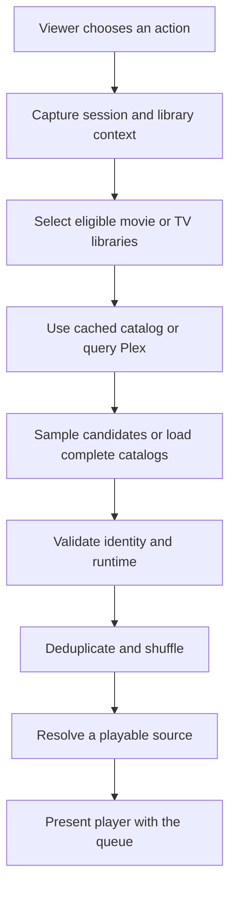
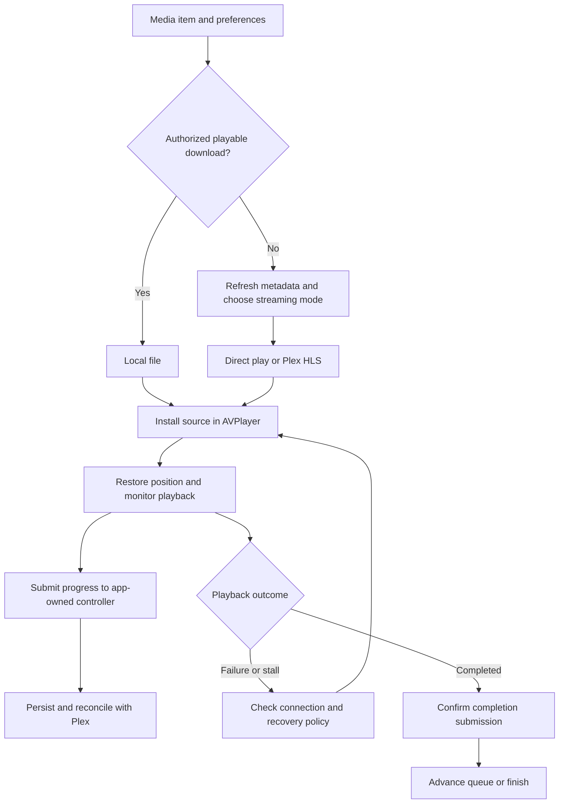

# Technical discussions

Code-grounded explanations of how Cuehouse's subsystems work, the decisions they encode, and their limits. These discussions describe the product's implementation; they do not imply manual authorship of every subsystem.

## Discussion 1: From a shuffle request to playback

**Scope:** iPhone/iPad Home controls and shared selection services, reviewed November 1, 2026. Mac and Apple TV parity has not been established by this review.

### Responsibilities and data flow

The SwiftUI Home view translates a button press into a selection scope, an optional runtime limit, and an action-specific queue limit. It delegates asynchronous preparation to a controller rather than doing the complete operation in the button handler.

The controller manages preparation state, cancellation, a deadline, and user-facing failures. A shuffle service provides library counts and media items from either saved catalog data or Plex. Queue construction validates those items before the view resolves a playback source and hands the result to the playback presenter.

This separates choosing candidates from resolving an actual playable URL. A catalog entry alone is not treated as proof that a stream can start.

### Catalog selection and sampling

Movie libraries supply movies; TV libraries supply individual episodes. Play Anything and time-based selection include both kinds. Random Movie and Random Episode restrict the scope.

Each shuffle-service instance keeps its chosen source for each library for that request. Counts and sampled items therefore use the same selected source instead of switching between cached data and server data midway through preparation. This does not make a changing remote Plex library an atomic snapshot.

For capped requests, the catalog first obtains eligible counts. It distributes the available slots by randomly drawing from the remaining counts: a library with more eligible titles has proportionately more opportunities to contribute. Cached candidates are shuffled locally; server candidates use the library service's random-item request. Catalog work runs with at most three libraries in flight.

Limits are independently stored for each action: 10, 25, 50, 100, 300, or Unlimited, with 50 as the default. Unlimited loads complete catalogs. This cap bounds the candidate selection, not playback duration.

### Validation and queue construction

Loaded items must have the expected media type, a nonempty item identifier, and no conflicting library identifier. The queue then removes duplicate item identifiers and performs a uniform shuffle. There is no viewing-history weighting, show grouping, or remembered shuffle order in this path.

Time-based selection requires a known positive runtime strictly below the chosen limit. A single-part media duration can serve as a fallback when the full item duration is unavailable; ambiguous multipart runtime is excluded. The filter applies to each title's full runtime, not remaining playback time or the sum of the queue.

For example, choosing 30 minutes can yield several episodes individually shorter than 30 minutes. It does not create a 30-minute session or schedule a playback stop.

### Resolving playback and handling failure

Before presentation, the startup path resolves a preferred playback source and rechecks item identity, media type, authorization context, and runtime eligibility.

Startup considers up to five candidates. Missing titles and selected title-specific failures, such as no playable media, allow another candidate. Authorization, connection, and invalid-response failures stop the attempt rather than repeating the same problem across the queue.

The player receives the resolved URL, resolved item, and generated queue. Discussion 2 follows that handoff through the playback lifecycle.

### Concurrency and stale results

Preparation captures the playback owner, authorization namespace, server URL, connection revision, and libraries. Context checks after asynchronous work prevent a result for an earlier session from being presented in the current one.

A generation counter distinguishes the current operation from canceled or replaced operations. The UI cancels pending preparation when relevant context or limits change, when permissions change, or when the controls become inactive or disappear.

A 60-second deadline bounds preparation. The interface distinguishes catalog loading from playback startup and exposes cancellation. These mechanisms address pending work; they are not a guarantee that every live-network failure has been tested.

## Discussion 2: Playback lifecycle and recovery

**Scope:** iPhone/iPad player orchestration and shared Plex resolution and progress-persistence services, reviewed November 1, 2026. Apple TV and Mac have separate player implementations; this discussion does not establish identical behavior on those platforms.

### Architecture: resolving a source and running a session

Playback crosses three responsibilities. The shared resolver turns a media item and playback preferences into a validated source. The iPhone/iPad player coordinates AVPlayer, controls, source changes, queue navigation, and recovery. An app-owned progress controller persists viewing updates and reconciles them with Plex.

AVPlayer handles media playback. Cuehouse supplies the policy around it: which source to open, when to replace it, which position to restore, and whether an asynchronous result still belongs to the current session.

### Source selection: local, direct, or server-converted

The preferred-source resolver first checks for an authorized download associated with the account, server, and title. It validates playability and then confirms the authorization again after that asynchronous check. A removed, replaced, or revoked download cannot be accepted solely because it existed before validation.

Streaming resolution obtains detailed media metadata, selects a media version and part, and validates requested audio and subtitle streams. This path explicitly rejects multipart media; it does not silently treat the first part as a complete title.

The streaming choices have different costs:

| Mode | Role in the reviewed path | Tradeoff |
| --- | --- | --- |
| Direct play | Open the original media part when compatibility, quality, and subtitle conditions permit. | Avoids a server conversion, but depends on source compatibility. |
| Direct stream | Request Plex HLS with direct streaming permitted. | Allows server packaging without necessarily re-encoding video; Plex determines the actual output. |
| Transcode | Request server-converted output with an explicit client profile and quality constraints. | Adds server work and startup preparation to improve compatibility or meet a quality selection. |
| Compatibility transcode | Use a more conservative conversion path. | May lower output quality and disables subtitles in this fallback. |

Supported native HDR sources are preferred before conversion. Eligible HDR10 conversion is a conditional path, not a promise that every source or server preserves HDR. Subtitle selection, HEVC compatibility, quality settings, and forced fallback can change the chosen route.

Before starting a transcode, the service asks Plex for its conversion decision and validates the response. An explicit rejection can advance to the next configured candidate, using a fresh session. Other errors are not indiscriminately treated as a reason to try every codec option.

### Startup, resume, and visible playback

The player begins with the item's saved viewing position, unless a valid initial resume override is supplied, such as a handoff position. The override must be finite and nonnegative and is bounded by a known duration. It survives failed preparation but is consumed after the first successful source installation so it cannot leak into later queue navigation.

Installing a URL is only one startup milestone. Cuehouse also observes player status, buffering, and video presentation. First-frame monitoring can initiate recovery when the player has not established visible playback. Picture in Picture has a separate progress-based check, since the inline video surface is not the appropriate evidence in that mode.

Seeking has its own request identity and watchdog. An older seek callback must not complete a newer seek. The recovery path can retain the intended target position when a seek does not recover normally.

### Queue transitions and completion

The queue is a list of media items with an explicit current position. After playback is established, the player can warm the next item's detailed metadata. Reuse requires a match on queue position, item identity, and playback owner; this is metadata preparation, not a claim that the next video has already buffered.

Automatic completion advances without wrapping. If there is no explicit queue and an episode finishes, the player loads the containing episode list and attempts the next entry. If there is no next entry, it finishes the presentation.

Completion first passes through an app-owned submission gate. Normally the controller persists completion mutations locally and schedules reconciliation with Plex. If local persistence fails and a matching client is available, it can attempt direct submission instead. Navigation proceeds only when the completion operation reports success for the still-current item; failure leaves a retryable state.

This makes successful completion submission distinct from immediate server synchronization. A saved local update can allow progress while Plex synchronization happens later. A manual queue selection already in progress also owns the transition: the outgoing item's end event must not start a competing automatic advance.

### Progress reporting and durable updates

The player reports the title identifier, offset, duration, and playing, paused, or stopped state. Positions are bounded to the duration, and invalid offsets or unknown/nonpositive durations are excluded from this reporting path.

A dedicated timeline coordinator serializes live submissions and buffers pending work. For the same title and state, ordinary reports are suppressed when the offset has changed by less than 12 seconds. This is a position-delta throttle, not a guarantee of one network request every 12 wall-clock seconds. Forced reports and state changes take different paths.

Checkpoints and terminal reports capture an app-owned submission sink so they can finish after the player view disappears. Submission sequence numbers preserve creation order when asynchronous operations finish out of order. Account/server ownership accompanies updates, and reporting guards respect manual watch-state preservation.

### Recovery and concurrency

Recovery distinguishes transport trouble from failures that permit a different media representation. It checks network availability, can wait for connectivity, attempts connection recovery where appropriate, and can schedule a retry or advance a media fallback. A failed local source can move toward streaming when connectivity permits.

Fallback retains playback intent, including position and whether playback should resume. Retired Plex conversion sessions receive best-effort cleanup; cleanup failure must not block the replacement stream.

The central concurrency problem is that an old player item can still emit events while a new title, quality, audio track, or subtitle source is being prepared. Recovery admission therefore checks the player instance, installed item, title, playback owner, and preparation token. It also defers recovery while a competing source replacement owns the transition.

For example, if a viewer selects title B while title A's recovery request is awaiting a response, A's late result must not reinstall A over B. These identity and generation checks make that ownership explicit.

### Engineering tradeoffs to discuss

- **Compatibility versus fidelity:** direct playback preserves the original source where eligible; conversion broadens playback options but costs server resources and may change quality or subtitles.
- **Responsiveness versus correctness:** warming metadata reduces repeated preparation, while identity checks prevent reuse for the wrong title or account.
- **Continuity versus synchronization:** local persistence lets completion survive intermittent connectivity without claiming Plex has already acknowledged it.
- **Automation versus user intent:** recovery and autoplay must yield to a newer manual selection, source change, or session owner.

## Further discussions

The following topics are planned for separate code reviews:

- **Application architecture:** shared services, platform-specific views, and state ownership.
- **Library data and search:** metadata loading, cache lifetimes, indexing, and refresh.
- **Offline downloads:** preparation, transfer, storage, validation, and access.
- **Platform adaptation:** touch, desktop input, and Apple TV remote interaction.

## Evidence boundary

These discussions are based on source inspection of Home selection and shuffle services, shared playback resolution and local authorization, the iPhone/iPad player's preparation, navigation, timeline, completion and recovery coordinators, and the pending-playback persistence controller. This review did not change application code or run new playback tests. It does not establish live-server, device, codec, or cross-platform reliability. Historical test results and their limits are documented in [Testing and validation](VALIDATION.md).

[Back to Cuehouse](README.md)
