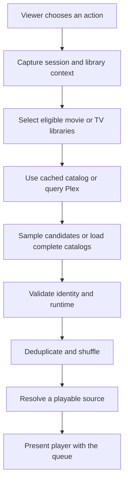

# Technical discussions

Code-grounded explanations of how Cuehouse's subsystems work, the decisions they encode, and their limits. These discussions describe the product's implementation; they do not imply manual authorship of every subsystem.

## Discussion 1: From a shuffle request to playback

**Scope:** iPhone/iPad Home controls and shared selection services, reviewed November 1, 2026. Mac and Apple TV parity has not been established by this review.

### Responsibilities and data flow

The SwiftUI Home view translates a button press into a selection scope, an optional runtime limit, and an action-specific queue limit. It delegates asynchronous preparation to a controller rather than doing the complete operation in the button handler.

The controller manages preparation state, cancellation, a deadline, and user-facing failures. A shuffle service provides library counts and media items from either saved catalog data or Plex. Queue construction validates those items before the view resolves a playback source and hands the result to the playback presenter.

This separates choosing candidates from resolving an actual playable URL. A catalog entry alone is not treated as proof that a stream can start.

### Catalog selection and sampling

Movie libraries supply movies; TV libraries supply individual episodes. Play Anything and time-based selection include both kinds. Random Movie and Random Episode restrict the scope.

Each shuffle-service instance keeps its chosen source for each library for that request. Counts and sampled items therefore use the same selected source instead of switching between cached data and server data midway through preparation. This does not make a changing remote Plex library an atomic snapshot.

For capped requests, the catalog first obtains eligible counts. It distributes the available slots by randomly drawing from the remaining counts: a library with more eligible titles has proportionately more opportunities to contribute. Cached candidates are shuffled locally; server candidates use the library service's random-item request. Catalog work runs with at most three libraries in flight.

Limits are independently stored for each action: 10, 25, 50, 100, 300, or Unlimited, with 50 as the default. Unlimited loads complete catalogs. This cap bounds the candidate selection, not playback duration.

### Validation and queue construction

Loaded items must have the expected media type, a nonempty item identifier, and no conflicting library identifier. The queue then removes duplicate item identifiers and performs a uniform shuffle. There is no viewing-history weighting, show grouping, or remembered shuffle order in this path.

Time-based selection requires a known positive runtime strictly below the chosen limit. A single-part media duration can serve as a fallback when the full item duration is unavailable; ambiguous multipart runtime is excluded. The filter applies to each title's full runtime, not remaining playback time or the sum of the queue.

For example, choosing 30 minutes can yield several episodes individually shorter than 30 minutes. It does not create a 30-minute session or schedule a playback stop.

### Resolving playback and handling failure

Before presentation, the startup path resolves a preferred playback source and rechecks item identity, media type, authorization context, and runtime eligibility.

Startup considers up to five candidates. Missing titles and selected title-specific failures, such as no playable media, allow another candidate. Authorization, connection, and invalid-response failures stop the attempt rather than repeating the same problem across the queue.

The player receives the resolved URL, resolved item, and generated queue. This discussion covers that handoff; queue advancement, resume behavior, and playback-progress reporting need their own review.

### Concurrency and stale results

Preparation captures the playback owner, authorization namespace, server URL, connection revision, and libraries. Context checks after asynchronous work prevent a result for an earlier session from being presented in the current one.

A generation counter distinguishes the current operation from canceled or replaced operations. The UI cancels pending preparation when relevant context or limits change, when permissions change, or when the controls become inactive or disappear.

A 60-second deadline bounds preparation. The interface distinguishes catalog loading from playback startup and exposes cancellation. These mechanisms address pending work; they are not a guarantee that every live-network failure has been tested.

## Further discussions

The following topics are planned for separate code reviews:

- **Application architecture:** shared services, platform-specific views, and state ownership.
- **Library data and search:** metadata loading, cache lifetimes, indexing, and refresh.
- **Playback lifecycle:** source selection, queue advancement, resume, progress reporting, and recovery.
- **Offline downloads:** preparation, transfer, storage, validation, and access.
- **Platform adaptation:** touch, desktop input, and Apple TV remote interaction.

## Evidence boundary

This first discussion is based on inspection of Home selection controls, the preparation controller, catalog sampling, and the shuffle service. It does not publish source code or claim a new end-to-end playback test. Historical test results and their limits are documented in [Testing and validation](VALIDATION.md).

[Back to Cuehouse](README.md)
